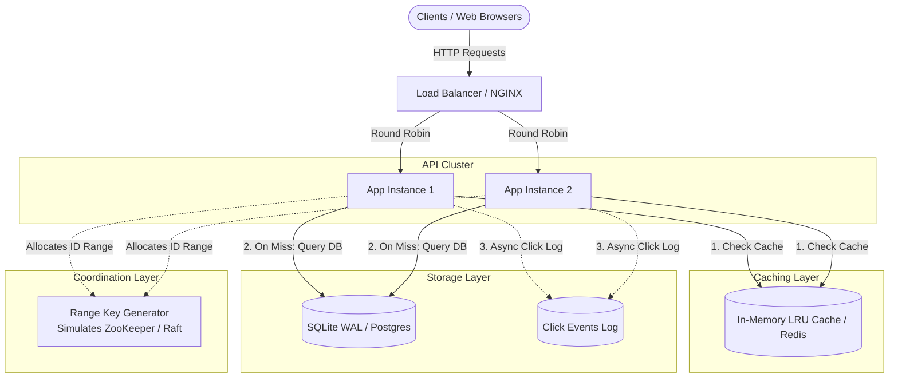

# 01 - Distributed URL Shortener (TinyURL)

A production-grade implementation of a distributed URL shortener designed to demonstrate key distributed systems patterns: **Distributed Key Generation (KGS)**, **Cache-Aside with LRU Eviction**, **Database Write-Ahead Logging (WAL)**, and **Sliding-Window Rate Limiting**.

---

## 1. High-Level Architecture



---

## 2. Capacity Estimations (System Design Calculations)

### Assumptions
* **Daily New URLs:** 10 Million new URLs shortened per day.
* **Read-to-Write Ratio:** 100:1 (heavily read-dominated).
* **Retention Policy:** 5 years.

### Traffic Estimates (QPS)
$$\text{Write QPS} = \frac{10,000,000}{86,400 \text{ seconds}} \approx 116 \text{ writes/sec}$$
$$\text{Read QPS} = 116 \times 100 \approx 11,600 \text{ reads/sec}$$
$$\text{Peak Read QPS (2x)} \approx 23,200 \text{ reads/sec}$$

### Storage Estimates (5 Years)
* Total URLs in 5 years: $10 \text{ million/day} \times 365 \times 5 = 18.25 \text{ Billion URLs}$.
* Bytes per record:
  * `short_code`: 7 bytes
  * `original_url`: ~500 bytes
  * `created_at` + `expires_at` + `click_count`: ~24 bytes
  * Total per record $\approx 550 \text{ bytes}$.
* **5-Year Storage:** $18.25 \times 10^9 \times 550 \text{ bytes} \approx 10 \text{ TB}$.

### Cache Sizing (80/20 Rule)
* 20% of the daily traffic accounts for 80% of reads.
* Daily read requests: $10 \text{M} \times 100 = 1 \text{ Billion reads/day}$.
* Hot URLs cached per day: $20\% \text{ of } 1 \text{B} \approx 200 \text{ Million URLs}$.
* **Cache Memory Needed:** $200 \times 10^6 \times 500 \text{ bytes} \approx 100 \text{ GB}$ (distributed across Redis cluster).

---

## 3. Key Design Trade-Offs

### 1. ID Generation: Range KGS vs. Hash Truncation
* **Hash Truncation (MD5/SHA256):** Taking the first 6 chars of a hash creates collisions at scale ($62^6 \approx 56.8\text{B}$). Resolving collisions requires database probing (appending a salt and re-hashing), introducing disk/network round-trips.
* **Range-based KGS (Implemented):** A central coordinator assigns distinct numeric blocks (e.g., Worker 1 gets `1M..2M`, Worker 2 gets `2M..3M`). Workers increment an in-memory counter atomically and Base62-encode it. **Result: $O(1)$ zero collisions, zero network coordination during request serving.**

### 2. HTTP 307 Temporary vs. 301 Permanent Redirect
* **301 Permanent Redirect:** The browser caches the redirection locally. Subsequent clicks bypass our server completely. **Drawback:** Destroys click analytics and prevents expiring URLs.
* **307 Temporary Redirect (Implemented):** The browser always queries our server first, allowing us to track clicks, enforce TTLs, and log analytics asynchronously.

### 3. Cache-Aside Pattern
* Reads check the in-memory LRU cache first ($< 1\text{ms}$).
* On cache miss, reads fall back to SQLite, then populate the cache.
* New writes warm the cache immediately to eliminate cold-start cache misses.

---

## 4. Project Structure

```
01-url-shortener/
├── app/
│   ├── config.py         # Service settings & KGS partition configurations
│   ├── key_generator.py  # Base62 encoder & RangeKeyGenerator
│   ├── cache.py          # Thread-safe LRU cache with TTL & telemetry
│   ├── storage.py        # SQLite WAL storage engine with B-Tree indexes
│   ├── rate_limiter.py   # Sliding window rate limiter
│   └── main.py           # FastAPI service, 307 redirects, and web dashboard
├── tests/
│   └── test_shortener.py # Unit and integration test suite
├── benchmark.py          # Async high-concurrency load simulator
├── requirements.txt      # Dependencies
└── README.md             # Architecture & system design writeup
```

---

## 5. Running the Project

### Setup Environment
```bash
# Activate virtual environment
.\.venv\Scripts\activate   # Windows
# or: source .venv/bin/activate (macOS/Linux)
```

### Run Server
```bash
python -m uvicorn app.main:app --host 127.0.0.1 --port 8000 --reload
```
* **Interactive Dashboard:** Open [http://127.0.0.1:8000/](http://127.0.0.1:8000/) in your browser.
* **API Documentation (Swagger UI):** Open [http://127.0.0.1:8000/docs](http://127.0.0.1:8000/docs).

### Run Test Suite
```bash
python -m unittest discover -s tests -v
```

### Run Concurrency & Latency Benchmark
With the server running in a separate terminal:
```bash
python benchmark.py
```
This simulates 25 concurrent workers firing 1,000 requests using an 80/20 Pareto distribution and outputs p50, p90, p95, and p99 latency percentiles alongside live cache hit rates.
