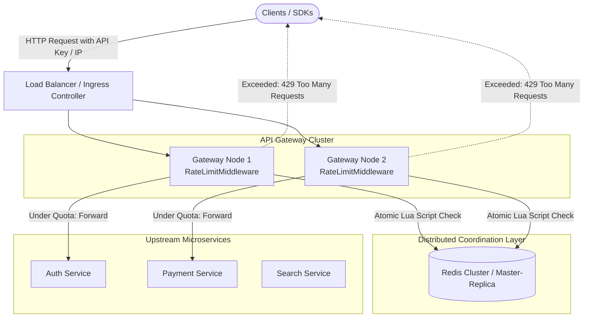

# 02 - Distributed Rate Limiter & API Gateway Middleware

A comprehensive implementation and comparative study of the **5 core rate limiting algorithms** used in high-scale distributed systems and API gateways (e.g., Kong, Cloudflare, AWS API Gateway, Envoy).

---

## 1. High-Level Architecture



---

## 2. Algorithm Comparison Matrix

| Algorithm | Time Complexity | Memory per Client | Allows Bursts? | Traffic Smoothing | Accuracy | Best Used For |
|---|---|---|---|---|---|---|
| **Token Bucket** | $O(1)$ | $O(1)$ (2 floats) | **Yes** (up to capacity $C$) | Moderate | High | General REST APIs, AWS / Stripe style |
| **Leaky Bucket** | $O(1)$ | $O(1)$ (2 floats) | **No** (buffers then drops) | **Strict** (constant egress) | High | Egress traffic shaping, Kafka ingestion, DB writes |
| **Fixed Window** | $O(1)$ | $O(1)$ (1 integer) | **Vulnerable** ($2\times$ burst at border) | Low | Low (border spikes) | Coarse hourly/monthly billing quotas |
| **Sliding Window Log** | $O(\log N)$ or $O(N)$ | $O(N)$ (list of timestamps) | **No** (exact window) | High | **100% Exact** | Low-volume, mission-critical operations (login attempts) |
| **Sliding Window Counter** | $O(1)$ | $O(1)$ (2 integers) | **No** (smooth decay) | High | **99.95%** (approximated) | High-scale API gateways (Cloudflare standard) |

---

## 3. Distributed Concurrency: Why Redis Lua Scripts?

### The Race Condition Problem
In a distributed setup with multiple API Gateway instances, a naive multi-step check:
```
1. count = redis.get(user_id)
2. if count < limit:
3.     redis.set(user_id, count + 1)
```
fails when concurrent requests hit Gateway 1 and Gateway 2 at the exact same millisecond. Both read `count = 9`, both decide `9 < 10`, and both increment, exceeding the quota!

### The Solution: Atomic Execution via Redis Lua
Redis guarantees that Lua scripts execute **atomically in a single thread**:
* No concurrent command can interleave during execution.
* Zero round-trip network hops between read, check, and decrement.
* Avoids distributed lock contention (`SETNX` / Redlock).

See [`app/redis_scripts.py`](file:///c:/Users/nikhi/OneDrive/Desktop/system%20design/02-rate-limiter/app/redis_scripts.py) for production Lua scripts for Token Bucket, Sliding Window Log, and Sliding Window Counter.

---

## 4. RFC Standard Response Headers

Every request processed by the gateway middleware returns standard rate limit headers:
* `X-RateLimit-Limit`: Maximum requests permitted in the current quota window.
* `X-RateLimit-Remaining`: Number of requests remaining for the caller.
* `X-RateLimit-Reset`: Number of seconds until quota is fully replenished or window resets.
* `Retry-After` *(Returned on HTTP 429)*: Number of seconds the client must wait before making another request.

---

## 5. Project Structure

```
02-rate-limiter/
├── app/
│   ├── algorithms/
│   │   ├── base.py                   # Common RateLimiter interface & RateLimitResult dataclass
│   │   ├── token_bucket.py           # Token Bucket with continuous time replenishment
│   │   ├── leaky_bucket.py           # Leaky Bucket with buffer queue emulation
│   │   ├── fixed_window.py           # Fixed Window Counter
│   │   ├── sliding_window_log.py     # Sliding Window Log (exact timestamp pruning)
│   │   └── sliding_window_counter.py # Sliding Window Counter (weighted approximation)
│   ├── middleware.py                 # FastAPI rate-limiting middleware & RFC header injection
│   ├── redis_scripts.py              # Production Redis Lua scripts for distributed environments
│   └── main.py                       # API Gateway simulator & interactive web dashboard
├── tests/
│   └── test_rate_limiters.py         # Unit tests, edge cases, and concurrency race-condition tests
├── benchmark.py                      # Burst vs. sustained load comparison script
├── requirements.txt                  # Dependencies
└── README.md                         # System design case study & complexity matrix
```

---

## 6. Running the Project

### Setup Environment
```bash
# Activate virtual environment
.\.venv\Scripts\activate   # Windows
# or: source .venv/bin/activate (macOS/Linux)
```

### Run Server
```bash
python -m uvicorn app.main:app --host 127.0.0.1 --port 8000 --reload
```
* **Interactive Dashboard:** Open [http://127.0.0.1:8000/](http://127.0.0.1:8000/) in your browser. Send single clicks or trigger 8-request bursts to watch the bucket states update in real time!
* **API Documentation (Swagger UI):** Open [http://127.0.0.1:8000/docs](http://127.0.0.1:8000/docs).

### Run Test Suite
```bash
python -m unittest discover -s tests -v
```

### Run Multi-Algorithm Benchmark
```bash
python benchmark.py
```
Simulates instantaneous 30-request bursts against a quota of 10, followed by sustained paced traffic to evaluate replenishment rates side-by-side.
