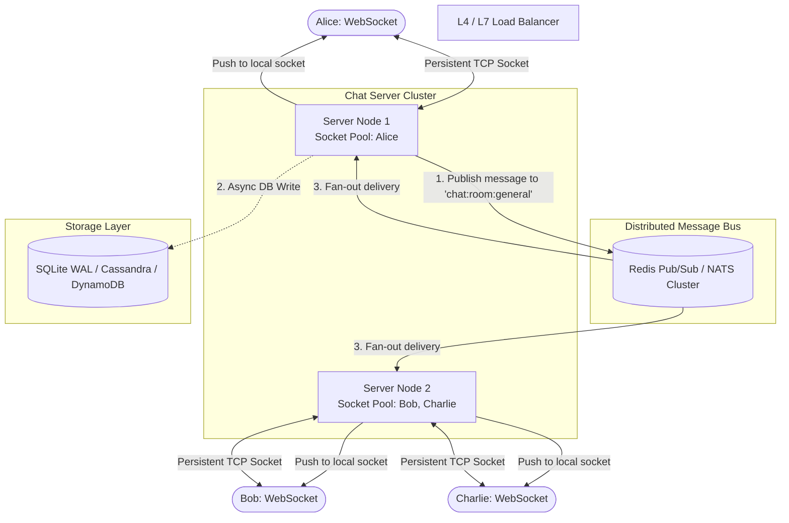

# 04 - Real-Time Chat & Distributed Pub/Sub Architecture

A production-grade real-time messaging engine built to demonstrate the distributed systems principles behind **Slack, Discord, and WhatsApp Web**: **Stateful WebSocket Connection Management**, **Cross-Node Fan-Out via Pub/Sub**, and **Monotonic Message Sequencing**.

---

## 1. High-Level Architecture



---

## 2. Key System Design Bottlenecks

### 1. Stateful vs. Stateless Scaling
In standard REST services, servers are stateless: any request can be routed to any instance. WebSockets maintain long-lived stateful TCP connections. 
* **The Problem:** If User A is on Node 1 and User B is on Node 2, Node 1 cannot send data directly to User B's socket.
* **The Solution:** A distributed Pub/Sub broker (e.g. Redis Pub/Sub). Server instances subscribe to room channels and fan out messages to locally connected sockets.

### 2. Connection Memory & File Descriptors
* Each open socket is represented as a File Descriptor (`fd`) in the OS.
* In Linux, default limits (`ulimit -n 1024`) must be tuned to `65535` or `1,000,000`.
* Memory per idle socket: ~10KB–30KB. Handling 1 million concurrent sockets requires ~20–30 GB RAM dedicated purely to connection state.

### 3. Message Sequencing vs. Clock Skew
* Physical server clocks drift (NTP synchronization is imperfect). Relying strictly on client or server timestamps creates out-of-order anomalies.
* **Our Solution:** An atomic, monotonic `seq_id` generated per room. Clients can immediately detect missed packets (e.g., if message #12 arrives after #10, the client knows #11 was dropped and triggers a re-fetch).

---

## 3. Project Structure

```
04-realtime-chat/
├── app/
│   ├── config.py             # Server settings & node identifier
│   ├── pubsub.py             # Pub/Sub broker abstraction (in-memory multi-node + Redis)
│   ├── connection_manager.py # Thread-safe WebSocket socket pool per room
│   ├── storage.py            # SQLite WAL message persistence with monotonic sequence IDs
│   └── main.py               # FastAPI app, WebSocket routes, & dual-client split UI
├── tests/
│   └── test_chat.py          # Unit & multi-client WebSocket integration tests
├── benchmark.py              # 25-client concurrent fan-out latency benchmark
├── requirements.txt          # Dependencies
└── README.md                 # System design case study & architecture diagrams
```

---

## 4. Running the Project

### Setup Environment
```bash
# Activate virtual environment
.\.venv\Scripts\activate   # Windows
# or: source .venv/bin/activate (macOS/Linux)
```

### Start the Chat Server
```bash
python -m uvicorn app.main:app --host 127.0.0.1 --port 8000 --reload
```
* **Interactive Split-Screen UI:** Open [http://127.0.0.1:8000/](http://127.0.0.1:8000/) in your browser. It renders two chat panels side-by-side (Alice and Bob) connected via live WebSockets! Type a message as Alice to see it instantly appear in Bob's panel.
* **API Documentation (Swagger UI):** Open [http://127.0.0.1:8000/docs](http://127.0.0.1:8000/docs).

### Run Test Suite
```bash
python -m unittest discover -s tests -v
```

### Run Fan-Out Benchmark
```bash
python benchmark.py
```
Connects 25 concurrent clients to `#benchmark-room`, broadcasts 50 messages (1,250 total deliveries), and measures delivery latencies and throughput.
