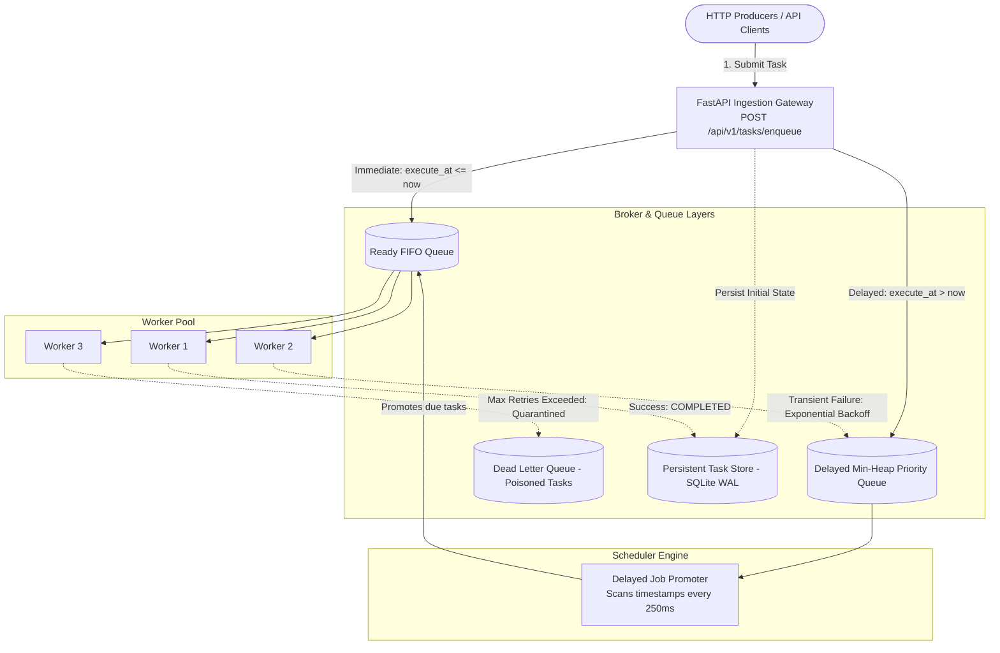

# 06 - Asynchronous Distributed Task Queue & Job Scheduler

A production-grade asynchronous distributed background task processing engine built from first principles demonstrating the distributed systems patterns behind **Celery, BullMQ, Sidekiq, and AWS SQS + Lambda**.

---

## 1. High-Level Architecture & Lifecycle



---

## 2. Key System Design Concepts

### 1. Producer-Consumer Decoupling
* **The Problem:** Heavy operations (image transcoding, PDF generation, bulk email dispatch) take seconds to minutes. Executing them synchronously within an HTTP request starves server threads and causes client timeouts.
* **The Solution:** The API validates the payload, enqueues the job into a broker in **sub-millisecond time**, returns an HTTP `202 Accepted` with a `task_id`, and worker threads pull and process tasks asynchronously.

### 2. At-Least-Once Delivery & Idempotency
* Network timeouts and worker crashes mean tasks can occasionally be re-delivered.
* **System Design Rule:** Task consumers must be **idempotent** (processing the same task multiple times produces the identical outcome, e.g. using unique transaction IDs or database upserts).

### 3. Exponential Backoff with Jitter
* When downstream dependencies experience transient failures (network blips, rate limits, database locks), retrying immediately creates a **Thundering Herd** problem that keeps the downstream service down.
* **Our Formula:**
  $$\text{delay} = \min(\text{max\_delay}, \text{base\_delay} \times \text{factor}^{\text{retries}}) + \text{jitter}$$
* Failed tasks are re-queued into the `DelayedQueue` with their future execution timestamp.

### 4. Dead Letter Queue (DLQ)
* **Poison Pills:** Corrupted data or permanent bugs will never succeed, no matter how many times they are retried.
* Without a DLQ, poison pills loop forever, consuming 100% of worker capacity.
* Once a task hits `max_retries`, it is quarantined in the DLQ and can be inspected or replayed via `POST /api/v1/dlq/{task_id}/retry`.

---

## 3. Project Structure

```
06-distributed-task-queue/
├── app/
│   ├── config.py             # Concurrency, backoff base, & scheduler timings
│   ├── models.py             # Task model, TaskState enum, & RetryPolicy
│   ├── storage.py            # SQLite WAL persistent state store & audit trails
│   ├── queue.py              # Broker: ReadyQueue, DelayedQueue, & DeadLetterQueue
│   ├── worker.py             # Concurrent WorkerPool & task handler execution
│   ├── scheduler.py          # Background delayed task promoter
│   └── main.py               # FastAPI gateway, REST routes, & live operations dashboard
├── tests/
│   └── test_task_queue.py    # Unit tests for FIFO, delayed execution, retries, & DLQ
├── benchmark.py              # High-throughput benchmark (1,000 tasks across 8 workers)
├── requirements.txt          # Dependencies
└── README.md                 # System design case study & architecture diagrams
```

---

## 4. Running the Project

### Setup Environment
```bash
# Activate virtual environment
.\.venv\Scripts\activate   # Windows
# or: source .venv/bin/activate (macOS/Linux)
```

### Start the Task Queue & Dashboard
```bash
python -m uvicorn app.main:app --host 127.0.0.1 --port 8000 --reload
```
* **Operations Dashboard:** Open [http://127.0.0.1:8000/](http://127.0.0.1:8000/) in your browser. Enqueue immediate or delayed tasks (`send_email`, `resize_image`, `flaky_task`, `poison_pill`), watch workers transition states in real time, and replay dead-letter jobs with one click!
* **API Documentation (Swagger UI):** Open [http://127.0.0.1:8000/docs](http://127.0.0.1:8000/docs).

### Run Test Suite
```bash
python -m unittest discover -s tests -v
```

### Run High-Throughput & Fault-Tolerance Benchmark
```bash
python benchmark.py
```
Submits 1,000 jobs (800 clean, 150 flaky with backoff, 50 poison pills) to an 8-worker pool and verifies **1,600+ tasks/sec processing throughput** with **100% perfect DLQ isolation**!
